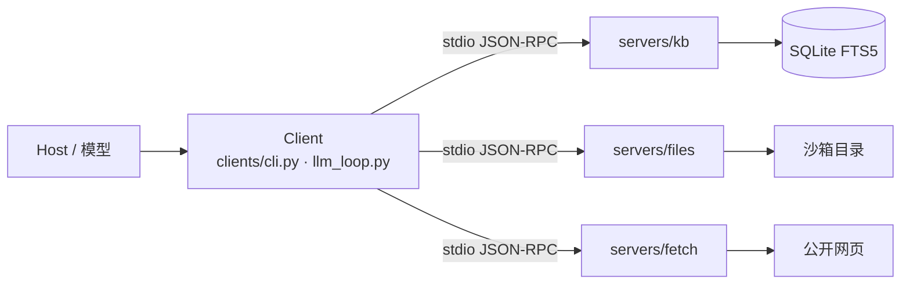

<div align="center">

# MCP Lab

**用三个真实服务器学会构建 MCP：可测试、有安全边界、能接自己的工具**

[](https://github.com/lizhongv/mcp-lab/actions/workflows/ci.yml)


[](LICENSE)

</div>

## 为什么是 MCP Lab

MCP（Model Context Protocol）的官方示例很多，但大多数只演示「能跑」。真正写一个能交给模型、又不会把服务器搞坏的 MCP 服务器，需要回答三个问题：

- **工具怎么设计**：名字、描述、参数 schema 怎么写，模型才不容易乱调？
- **边界怎么守**：模型被提示词注入后要求读 `/etc/passwd`、访问内网、执行命令，服务器靠什么拦住？
- **怎么证明它对**：除了手工点一遍，能不能用测试把行为钉住？

这个仓库用三个小而完整的服务器回答这三个问题：每个 100～200 行，业务逻辑与 MCP 绑定的代码分开，单元测试与协议级测试都齐。

## 三个服务器

| 服务器 | 工具 | 教什么 |
| --- | --- | --- |
| [`servers/kb`](servers/kb) | `search`、`get_document`、`list_documents` | 工具设计、SQLite FTS5 检索、短查询回退、分页与截断 |
| [`servers/files`](servers/files) | `list_files`、`read_text`、`write_text`、`stat_path` | **路径沙箱**、符号链接逃逸、只读优先、写操作显式开启 |
| [`servers/fetch`](servers/fetch) | `fetch_url` | HTTP 抓取、**SSRF 防护**、内容类型白名单、大小与超时限制 |

配套客户端：

- [`clients/cli.py`](clients/cli.py)：列出工具、调用一次工具，用来验证服务器；
- [`clients/llm_loop.py`](clients/llm_loop.py)：把 MCP 工具交给 OpenAI 兼容模型，走一遍完整的工具调用循环。

## 快速开始

需要 Python 3.10+ 与 [uv](https://docs.astral.sh/uv/)。

```bash
git clone https://github.com/lizhongv/mcp-lab.git
cd mcp-lab
uv sync
```

### 1. 看服务器暴露了哪些工具

```bash
uv run python -m clients.cli --server kb
```

```text
- search: 按关键词检索知识库，返回编号、标题、摘要与相关度分数。
- get_document: 按编号读取一篇文档的完整正文。
- list_documents: 列出知识库中的文档，用于发现有哪些内容可读。
```

### 2. 调用一次工具

```bash
uv run python -m clients.cli --server kb --tool search --args '{"query":"MCP"}'
```

```json
{"id": 3, "title": "MCP 工具的安全边界", "snippet": "# [MCP] 工具的安全边界…", "score": -1.46e-06}
{"id": 1, "title": "MCP 是什么", "snippet": "# [MCP] 是什么…", "score": -1.45e-06}
```

### 3. 让模型自己决定调用哪个工具

```bash
export OPENAI_API_KEY=...
export OPENAI_BASE_URL=https://api.deepseek.com     # 可选，OpenAI 兼容地址
export OPENAI_MODEL=deepseek-chat                   # 可选
uv run python -m clients.llm_loop --server kb "知识库里有哪些关于 RAG 的内容？"
```

### 4. 用官方 Inspector 手工调试

```bash
npx -y @modelcontextprotocol/inspector uv run python -m servers.kb.server
```

### 单独启动服务器

```bash
uv run python -m servers.kb.server
uv run python -m servers.files.server
uv run python -m servers.fetch.server
```

> 服务器通过 stdio 与客户端通信；直接用终端启动它会等待 stdin 上的 JSON-RPC 消息，这是正常现象。

## 架构



每个服务器都拆成两层：

- `core.py`：纯 Python 业务逻辑，可用普通单元测试覆盖；
- `server.py`：只负责把 `core` 暴露成 MCP 工具。

这样「协议层坏了」和「业务逻辑错了」是两类可区分的故障。

## 安全模型

这个仓库刻意把「模型不可信」写进代码：

| 能力 | 默认行为 |
| --- | --- |
| 文件路径 | 只接受相对路径；`resolve()` 后必须仍在根目录内；符号链接指向外面同样拒绝 |
| 文件写入 | **默认关闭**，需要 `MCP_FILES_ALLOW_WRITE=1` |
| 网页抓取 | 只允许 http/https；解析后拒绝回环、内网、链路本地、保留地址；不跟随重定向；10 秒 / 1 MB |
| 知识库 | 只读；查询长度与返回条数有上限 |
| 凭证 | 只从环境变量读取，代码与文档里不写 |

威胁模型与报告方式见 [SECURITY.md](SECURITY.md)。

## 项目结构

```text
mcp-lab/
├── servers/
│   ├── kb/           知识库检索：core.py + server.py
│   ├── files/        文件沙箱：core.py + server.py
│   └── fetch/        网页抓取：core.py + server.py
├── clients/          最小客户端、LLM 工具循环
├── shared/           路径沙箱、工具错误
├── tests/            单元测试 + 协议级 stdio 测试
├── docs/             五篇中文讲义
├── data/             合成样例文档与沙箱目录
└── pyproject.toml    uv / ruff / pytest
```

## 测试

```bash
uv run pytest -q
uv run ruff check .
```

覆盖范围：

- 路径穿越、绝对路径、符号链接逃逸；
- 写入开关、二进制文件、超大文件截断；
- 短中文查询回退、空查询、缺失文档；
- HTML 转文本、SSRF 拦截、非法协议；
- 真实启动 stdio 服务器的 `initialize → list_tools → call_tool`。

## 文档

- [01 · MCP 是什么](docs/01-what-is-mcp.md)
- [02 · 第一个服务器](docs/02-first-server.md)
- [03 · 工具设计](docs/03-tool-design.md)
- [04 · 安全边界](docs/04-security.md)
- [05 · 测试与接入](docs/05-testing.md)

## 版本说明

本仓库锁定 `mcp[cli]>=1.6,<2`：1.x 的 `FastMCP` API 与主流示例一致。MCP SDK 2.x 把 `FastMCP` 改名为 `MCPServer`，迁移时只需调整各 `server.py` 的导入与实例化，业务逻辑不受影响。

## 路线图

- [x] 知识库、文件沙箱、网页抓取三个服务器
- [x] 最小客户端与 LLM 工具调用循环
- [x] 单元测试 + 协议级测试 + 三平台 CI
- [ ] `git` 只读服务器（log / diff / show）
- [ ] 受限 `shell` 服务器（命令白名单 + 人工确认 + 审计日志）
- [ ] Streamable HTTP 传输示例
- [ ] 接入知源：把 `servers/kb` 作为检索工具
- [ ] 英文 README

## 参与贡献

欢迎提交 Issue 与 Pull Request。新增服务器的标准、测试要求与提交规范见 [CONTRIBUTING.md](CONTRIBUTING.md)。

## 许可证

[MIT](LICENSE)。样例文档为合成内容，不含任何真实业务数据。
